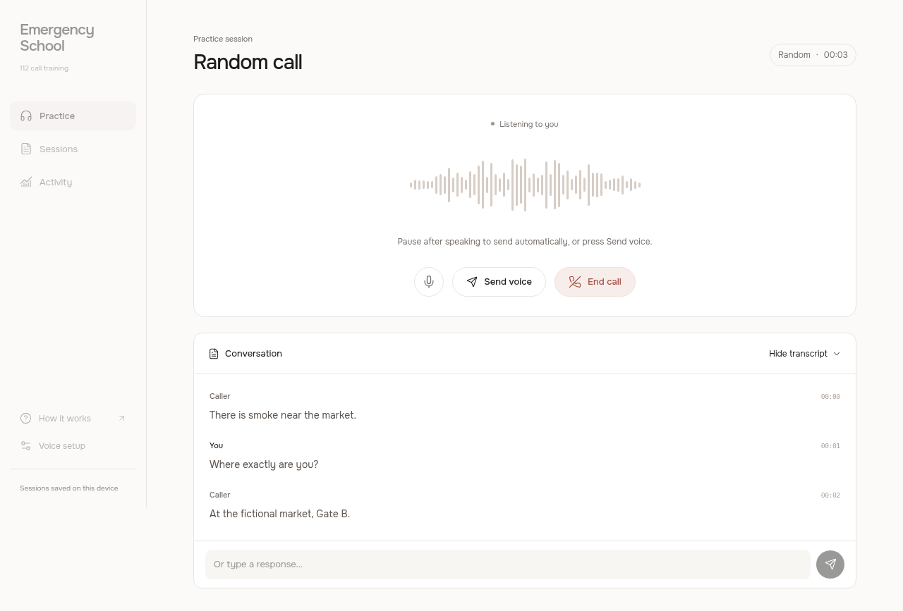
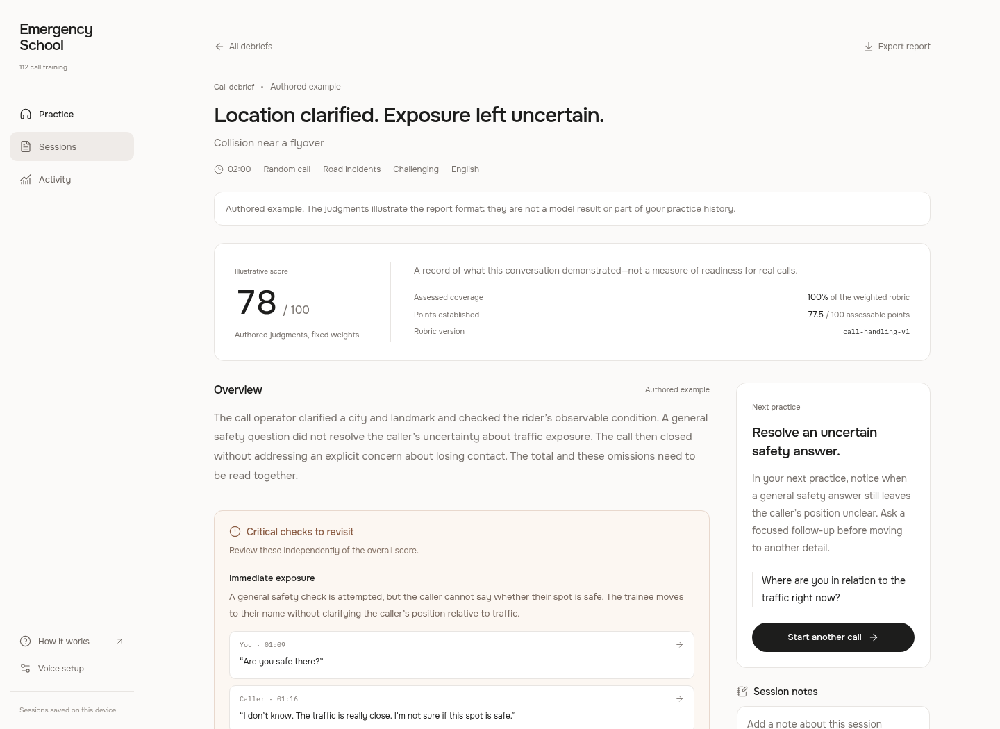

# Emergency School

Emergency School is a voice training room for 112 emergency call operators. An AI plays someone calling for help; you work out what happened, where they are, and what they can tell you. When you end the call, the review takes you back to your decisions—with the actual conversation as evidence.

No signup, phone number, or onboarding questionnaire. Open the practice room and start a call.

[Inside a call](#inside-a-call) · [The review](#after-the-call) · [Run locally](#run-locally) · [Developer guide](docs/development.md)

## Inside a call

- **An incident you haven't seen.** Random calls are the main experience. Each live session gets new incident facts and a caller personality; you discover the situation through your questions.
- **A caller with their own delivery.** Panic, hesitation, and scattered answers change the conversational challenge. OpenAI writes emotion and pacing directions; Fish Audio's Drama 3 speaks them. The underlying incident facts stay consistent.
- **Practice on your terms.** Start without choosing anything, or narrow the next call by incident type, difficulty, or language. There are 18 incident types, English and Hindi, and an optional guided mode with a briefing and question prompts.

<p align="center">
  
  <br>
  <sub>Call room preview with a synthetic test conversation. Live calls use OpenAI and Fish Audio.</sub>
</p>

## After the call

The review shows what you established and where you left important details unresolved. Scored checks sit alongside critical findings, so an overall number doesn't hide an unanswered safety question. Each finding links back to the transcript; you can inspect the evidence, keep reflection notes, export the report, and revisit sessions in your journal.

<p align="center">
  
  <br>
  <sub>Authored example report. The content and score illustrate the format, not a measured trainee result.</sub>
</p>

## Run locally

You need Node.js **22.12 or newer**, npm, and OpenAI and Fish Audio Developer API keys for live voice calls.

```sh
npm install --include=dev
cp .env.example .env
```

Add your keys to `.env`:

```dotenv
OPENAI_API_KEY=your_openai_api_key
FISH_API_KEY=your_fish_developer_api_key
```

```sh
npm run dev
```

Open [the practice room](http://127.0.0.1:5173) and allow microphone access. Restart the server after changing `.env`. Keys stay on the server; never prefix them with `VITE_` or commit `.env`.

Without keys, you can explore a labelled, scripted text sample. It does not use paid services or generate a performance grade.

## Development

Built with React, Vite, and a Node.js server. OpenAI handles the scenario, conversation, transcription, and proposed assessment findings; application code owns the scoring weights and arithmetic.

```sh
npm test          # Unit and backend checks; no paid requests
npm run build    # Production build
```

The [developer guide](docs/development.md) covers model and voice settings, browser tests, opt-in paid checks, scoring, data handling, and local production setup.

## Current limits

This is a training prototype, not a real 112 connection or a validated professional assessment. Scores use project-defined criteria informed by public training material; they do not certify readiness. The microphone pauses while the caller speaks, so interruptions are not supported yet. Hindi is selectable but still needs listening tests.

Use fictional information only. Voice turns go to OpenAI for transcription; caller dialogue goes to Fish for speech. Completed sessions stay in this browser, and provider retention policies still apply. The server is intended for local use, not public deployment as-is.
